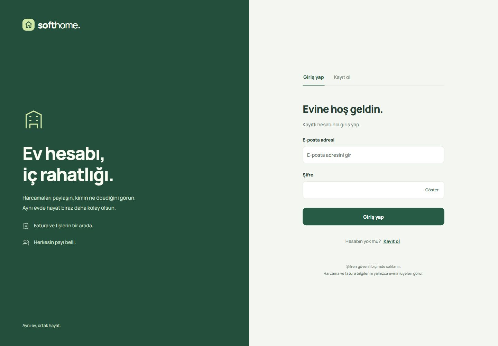

# SoftHome

**Ortak evin giderleri, herkes için anlaşılır.**

SoftHome; ev arkadaşlarının harcamalarını, fatura fotoğraflarını ve aralarındaki ödemeleri takip ettiği bir ortak ev bütçe uygulamasıdır. Adaçayı ve koyu yeşil tonlarındaki arayüz, gerçek hesaplar ve sunucudaki veritabanı ile çalışır.

## Giriş ekranı

[](docs/images/login-hd.jpg)

Görseli tam boy açmak için üzerine tıkla. Uygulama örnek kişi veya harcama oluşturmaz; ekrandaki adlar kayıtlı kullanıcıların veritabanındaki adlarından gelir.

## Özellikler

- **Gerçek hesaplar:** Kayıt, tek kullanımlık e-posta doğrulaması, şifre ile giriş ve çıkış.
- **Ev özeti:** Aylık gider, kişisel bakiye, kategori dağılımı ve aylık bütçe.
- **Harcama kaydı:** Tutar, kategori, tarih, ödeyen kişi ve paylaşıma katılan üyeler.
- **Fatura fotoğrafı:** Harcamaya JPEG, PNG veya WebP görsel ekleme; küçük önizleme, kaydetmeden kaldırma ve ayrıntıdan tam boy açma. Dosya sınırı 5 MB.
- **Borç paylaşımı:** Kuruş kaybetmeden eşit bölüşüm, net bakiyeler ve ödeme kaydı. Bu işlem para transferi yapmaz.
- **Gerçek ev arkadaşları:** Ev yöneticisinin oluşturduğu katılım koduyla, kendi hesabı bulunan kullanıcıların aynı eve katılması.
- **Görünüm:** Telefon ve masaüstü yerleşimi, açık/koyu tema, arama ve kategori filtreleri.

## Hesap ve veri akışı

1. Kullanıcı kendi adını, e-postasını ve şifresini yazar.
2. Doğrulama bağlantısı bu adrese gönderilir; bağlantı 24 saat geçerlidir ve bir kez kullanılabilir.
3. Doğrulanmış kullanıcı doğru şifreyle giriş yapar. Kayıtlı olmayan adres, yanlış şifre ve doğrulanmamış hesap giriş yapamaz.
4. Kullanıcının evi, üyeleri, harcamaları ve fatura fotoğrafları sunucudan yüklenir.
5. Ev arkadaşları ayrı hesap açar; ev yöneticisinin verdiği 7 günlük kodla aynı eve katılır. Kodu yalnızca evinize katılmasını istediğiniz kişilerle paylaşın.

E-posta biçimini kontrol etmek, posta kutusunun gerçekten var olduğunu kanıtlamaz. Bu nedenle e-posta doğrulanmadan oturum açılmaz. Gönderim hizmeti yapılandırılmamışsa kayıt işlemi açık bir hata verir; e-posta gönderilmiş veya hesap doğrulanmış gibi davranılmaz.

Şifreler tarayıcıya veya veritabanına düz metin olarak yazılmaz; ASP.NET Core PasswordHasher ile saklanır. Oturum HttpOnly / SameSite çereziyle yönetilir ve değişiklik isteklerinde CSRF doğrulaması uygulanır. Beş hatalı şifre denemesi hesabı 15 dakika kilitler. Her API isteği kullanıcının kendi evine göre sınırlandırılır; fatura görselleri herkese açık bir klasöre yüklenmez.

## Yerelde çalıştır

.NET 10 SDK gerekir. Arayüz ve API aynı sunucudan sunulur; yalnızca `frontend/index.html` dosyasını açmak hesap işlemleri için yeterli değildir.

```bash
git clone https://github.com/Halit1elnehsen/SoftHome.git
cd SoftHome
dotnet restore backend/SoftHome.Api/SoftHome.Api.csproj
dotnet run --project backend/SoftHome.Api/SoftHome.Api.csproj --launch-profile http
```

[localhost:5000](http://localhost:5000) adresini aç. Varsayılan yerel veri tabanı `backend/SoftHome.Api/data/softhome.db` dosyasında oluşturulur. İlk başlangıçta kullanıcı ve harcama listeleri boştur. Çalışma verileri ve oturum anahtarları Git'e dahil edilmez.

## E-posta doğrulamasını bağla

Bir SMTP gönderim hizmetinin bağlantı bilgileri gerekir. Aşağıdaki değerler örnektir; gerçek bilgileri sunucunun ortam değişkenlerine ekle. SMTP parolasını GitHub'a veya frontend dosyalarına yazma.

```powershell
$env:Email__SmtpHost = "smtp.example.com"
$env:Email__SmtpPort = "587"
$env:Email__SmtpUsername = "YOUR_SMTP_USERNAME"
$env:Email__SmtpPassword = "YOUR_SMTP_PASSWORD"
$env:Email__From = "verified-sender@example.com"
$env:PublicUrl = "http://localhost:5000"
dotnet run --project backend/SoftHome.Api/SoftHome.Api.csproj --launch-profile http
```

SMTP bağlantısında TLS kullanılır. `Email__From`, sağlayıcının gönderime izin verdiği adres olmalıdır. Canlı sunucuda `PublicUrl`, kullanıcının doğrulama bağlantısından açacağı **gerçek HTTPS adresi** olmalıdır. Hizmet bağlı değilken gerçek e-postalar gönderilmez ve yeni hesaplar etkinleştirilemez.

## Veritabanı

Varsayılan SQLite seçeneği yerel kullanım ve kalıcı diskli tek sunucu için hazırdır. Fatura görselleri harcamayla birlikte veritabanına tek kayıt işleminde yazılır. `data/` dizini ve oturum anahtarları kalıcı, özel bir diskte tutulmalı; veritabanı düzenli yedeklenmelidir.

Mevcut PostgreSQL / Supabase veritabanını kullanmak için:

```powershell
$env:Database__Provider = "Postgres"
$env:SUPABASE_CONNECTION = "YOUR_POSTGRES_CONNECTION_STRING"
dotnet tool restore
dotnet ef database update --project backend/SoftHome.Api/SoftHome.Api.csproj
```

`RealAccountsAndReceipts` geçişi yeni hesap, ev, ödeme ve fatura alanlarını ekler; eski kayıtları silmez. Mevcut veritabanına uygulamadan önce yedek alın. Eski sürümdeki örnek kullanıcılar doğrulanmış hesap sayılmaz; eski kayıtların gerçek hesaplara ve doğru eve bağlanması ayrıca yönetilmelidir. Tarayıcının eski localStorage kayıtları otomatik olarak güvenilir hesaplara dönüştürülmez.

## Testler ve derleme

```bash
dotnet test backend/SoftHome.Tests/SoftHome.Tests.csproj
npm ci --prefix tests/frontend
npm test --prefix tests/frontend
dotnet publish backend/SoftHome.Api/SoftHome.Api.csproj -c Release -o publish
```

Arayüz testleri Node.js 24 ile çalıştırılmıştır.

Testler; kayıtsız hesap, yanlış şifre, e-posta doğrulaması, CSRF, geçici kilit, gerçek kayıtlı adların arayüze yansıması, fotoğrafla birlikte harcama gönderimi, dosya boyutu/biçimi, evler arası erişim ayrımı, katılım kodu ve yinelenen ödeme isteklerini kapsar. Test posta servisi yalnızca test projesindedir; gerçek uygulamada kullanılamaz.

Yayın çıktısı frontend ve API'yi birlikte içerir. Canlı kullanım HTTPS gerektirir. Yalnızca statik dosya barındırmak bu sürümün sunucu tarafını çalıştırmaz; .NET 10 barındırabilen bir sunucu veya konteyner gerekir.

## Android

Android kabuğu aynı HTTPS uygulamasını açar ve fotoğraf seçim penceresini destekler. Derlemede kendi sunucu adresini ver:

```powershell
cd android
.\gradlew.bat :app:assembleDebug -PsoftHomeUrl=https://softhome.example.com
```

Sunucu adresi olmadan hazırlanan paket örnek hesaplarla çalışmaz; sunucu ayarının eksik olduğunu gösterir. Debug derlemesi geliştirme içindir; mağaza yayını için kendi release imzalama ayarların gerekir.

## Proje yapısı

- `frontend/`: Yeni arayüz, hesap ekranları ve API istemcisi.
- `backend/SoftHome.Api/`: .NET 10, kimlik doğrulama, ev bazında API ve fatura saklama.
- `backend/SoftHome.Api/Migrations/`: PostgreSQL şema geçişleri.
- `backend/SoftHome.Tests/`: SQLite üzerinde API bütünleşme testleri ve bölüşüm testleri.
- `tests/frontend/`: Harcama/fotoğraf gönderimi ve gerçek hesap adı testleri.
- `android/`: HTTPS sunucuya bağlanan Android WebView kabuğu.

## Ekip çalışması

`main` dalına doğrudan kod göndermek yerine özellik dalı ve Pull Request kullanılır.

```bash
git switch main
git pull --ff-only
git switch -c feature/gorev-adi
```

Teknik başvurular: [ASP.NET Core çerez kimlik doğrulaması](https://learn.microsoft.com/en-us/aspnet/core/security/authentication/cookie?view=aspnetcore-10.0), [dosya yükleme](https://learn.microsoft.com/en-us/aspnet/core/mvc/models/file-uploads?view=aspnetcore-10.0).

Geliştirici: [Halid Elnehsen](https://github.com/Halit1elnehsen)
