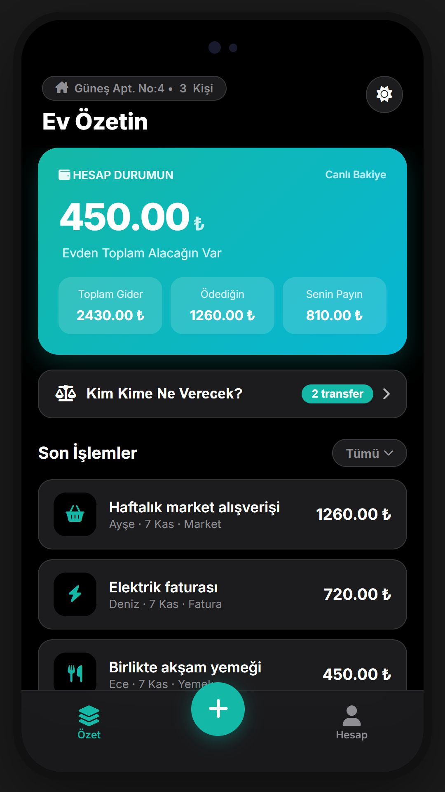
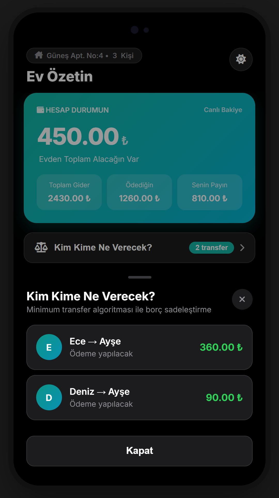

# SoftHome

**Ortak evin giderleri, herkes için anlaşılır.**

SoftHome, ev arkadaşlarının ortak harcamalarını kaydetmesini, kimin ne kadar ödediğini görmesini ve kalan borçları takip etmesini sağlayan bir ortak ev bütçe projesidir. Ev özetinden harcama detayına ve borç paylaşımına kadar günlük işlemleri tek arayüzde toplar.

[Canlı arayüz demosu](https://halidenehsen.netlify.app/previews/softhome/) · [Portfolyo](https://halidenehsen.netlify.app/)

## Ekran görüntüleri

### Ev özeti ve borç paylaşımı

<p align="center">
  <a href="docs/images/overview-hd.jpg"></a>
  <a href="docs/images/settlements-hd.jpg"></a>
</p>

**Solda:** evin genel bütçesi ve son işlemler. **Sağda:** net bakiyelere göre ödeme önerileri.

Her iki görsel **1080 × 1920** çözünürlükte, çalışan arayüzden yeniden alınmıştır. Tam boy görüntülemek için görsele tıkla. Gösterilen kişiler ve harcamalar dokümantasyon amaçlı örnek verilerdir.

## Özellikler

- **Ev özeti:** Toplam gider, ödediğin tutar, sana düşen pay ve net bakiye.
- **Harcama kaydı:** Tutar, açıklama, kategori, ödeyen kişi ve paylaşılacak ev üyeleri.
- **Borç paylaşımı:** Kişiler arasındaki net bakiyelerden ödeme önerileri oluşturma.
- **Fiş ve fatura:** Harcamaya görsel ekleme ve detay ekranında görüntüleme.
- **Ev üyeleri:** Paylaşıma katılan kişileri yönetme.
- **Görünüm:** Açık/koyu tema ve telefona uygun arayüz.

Örnek akış: bir market harcaması ekle, ödeyen kişiyi seç, paylaşıma katılan ev arkadaşlarını belirle ve **Kim Kime Ne Verecek?** ekranından net bakiyeleri incele.

## Projenin katmanları

- `frontend/`: HTML, CSS ve JavaScript ile geliştirilen bağımsız tarayıcı demosu; uygulama verilerini **localStorage** içinde saklar.
- `backend/SoftHome.Api/`: ASP.NET Core **.NET 10**, Entity Framework Core ve PostgreSQL kullanan ayrı API projesi.
- `backend/SoftHome.Tests/`: API tarafının test projesi.
- `android/`: Android uygulama yapısı ve paketleme dosyaları.
- `schema.sql`, `database_schema.md`: Veritabanı şeması ve açıklamaları.
- `docs/images/`: Bu sayfadaki arayüz görselleri.

Canlı demo, tarayıcı arayüzünü gösterir. Mevcut frontend doğrudan API'ye bağlanmaz; tarayıcıdaki hesap ve harcama verileri cihazlar arasında eşitlenmez. Demo giriş sistemi üretim amaçlı kimlik doğrulama yerine geçmez; gerçek parolanı veya hassas finansal bilgilerini kullanma.

## Arayüzü yerelde çalıştır

Python 3 ile basit bir statik sunucu yeterlidir:

```bash
git clone https://github.com/Halit1elnehsen/SoftHome.git
cd SoftHome
python -m http.server 8080 --directory frontend
```

Tarayıcıda [localhost:8080](http://localhost:8080) adresini aç. Demo hesabı ve kayıtları aynı tarayıcıda tutulur; site verilerini temizlemek bunları siler. Arayüzdeki harici font ve ikon kaynakları internet gerektirebilir.

## API'yi yerelde çalıştır

.NET 10 SDK ve erişilebilir bir PostgreSQL veritabanı gerekir. `SUPABASE_CONNECTION` ortam değişkenini kendi PostgreSQL bağlantı dizenle ayarla. Uygulama bu değişkeni okur; tanımlı değilse yapılandırmadaki `DefaultConnection` değerini kullanır.

PowerShell örneği:

```powershell
$env:SUPABASE_CONNECTION = "Host=localhost;Port=5432;Database=SoftHomeDb;Username=YOUR_USER;Password=YOUR_PASSWORD"
dotnet restore backend/SoftHome.Api/SoftHome.Api.csproj
dotnet run --project backend/SoftHome.Api/SoftHome.Api.csproj --launch-profile http
```

API belgeleri: [localhost:5000/swagger](http://localhost:5000/swagger). Geliştirme başlangıcında veritabanı oluşturma ve örnek veri ekleme kodu çalışır; geliştirme için ayrı bir veritabanı kullan.

```bash
dotnet test backend/SoftHome.Tests/SoftHome.Tests.csproj
```

Bağlantı parolalarını ve `.env` dosyalarını Git'e ekleme. Üretim kullanımı için güvenli kimlik doğrulama, sunucu üzerinden veri paylaşımı ve ortam yapılandırması ayrıca tamamlanmalıdır.

## Ekip çalışması

Bu proje ekip çalışması için düzenlenmiştir. `main` dalına doğrudan kod göndermek yerine bir özellik dalı açılır ve Pull Request üzerinden inceleme yapılır.

```bash
git switch main
git pull --ff-only
git switch -c feature/gorev-adi
git add <degisen-dosyalar>
git commit -m "feat: degisikligin aciklamasi"
git push -u origin feature/gorev-adi
```

Ardından `main` dalına Pull Request açılır.

Proje hesabı: [Halit1elnehsen](https://github.com/Halit1elnehsen)
