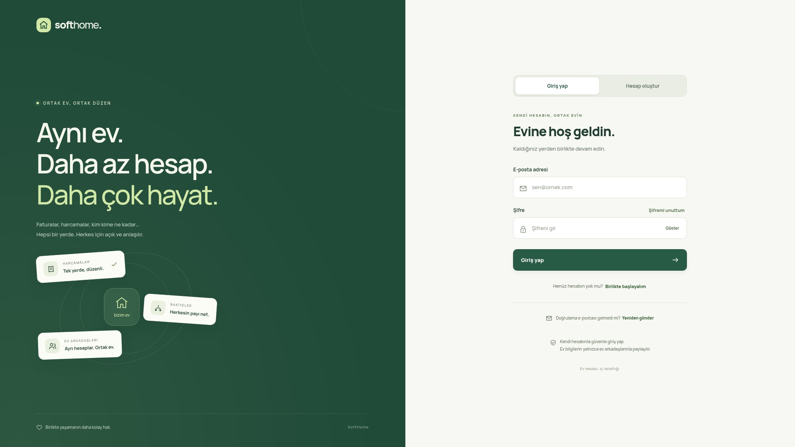

# SoftHome

**Ortak evin giderleri, herkes için anlaşılır.**

Ev arkadaşları için özel Android uygulaması. Herkes kendi e-posta hesabıyla giriş yapar; aynı ev koduyla katılan kişiler ortak harcamaları, fatura fotoğraflarını ve bakiyeleri görür.

[](docs/images/login-hd.jpg)

## Android sürümü

- E-postaya gelen **6 haneli kodla** kayıt doğrulaması; şifreyle giriş ve kodla şifre kurtarma.
- Doğrulamadan sonra **ev kur / davet koduyla katıl** seçimi; katılan kişiden ev adı istenmez.
- **Profilim ve ayarlar:** hesap adı, e-posta, ev rolü; ev yöneticisine özel ad/bütçe ayarları ve profil içinde çıkış.
- Harcama, kategori, bütçe ve fatura fotoğrafı; kuruş kaybetmeden eşit paylaşım.
- İstek kimliğiyle tekrarlı kaydı önleyen ödeme takibi. Gerçek para transferi yapmaz.
- Uygulama açıkken **anlık ortak güncelleme**, kalıcı bildirim geçmişi ve kişiye özel okunma durumu.
- Telefona uygun adaçayı/yeşil arayüz, basılma derinliği olan düğmeler, açık/koyu tema ve arama.
- Kayıtlı oturum açılırken giriş ekranı gösterilmez; aşağı çekerek yenileme üç noktalı göstergeyle çalışır.

Arayüz APK'nın içindedir. Ortak hizmet Supabase'dir; ayrı ücretli sunucu veya web sitesi yayını gerekmez. Free plan ve Gmail kullanım sınırları geçerlidir. Uygulama kapalıyken sistem push bildirimi bu sürümde yoktur; açıldığında okunmamış haberler yüklenir.

**APK indirme:** [SoftHome 1.4.0 APK'yı doğrudan indir](https://raw.githubusercontent.com/Halit1elnehsen/SoftHome/main/downloads/SoftHome-1.4.0.apk). Hazır paket `downloads/SoftHome-1.4.0.apk` konumundadır.

**Kurulum, e-posta şablonları, güvenlik ve APK derlemesi:** [Özel Android kılavuzu](docs/private-android.md).

```bash
npm ci --prefix frontend
npm run build --prefix frontend
cd android
./gradlew :app:assembleDebug
```

Java 17 ve Android SDK 34 gerekir. Paket `android/app/build/outputs/apk/debug/app-debug.apk` konumunda oluşur. `softHomeUrl` verilmezse paketli Supabase sürümü açılır. SMTP parolası ve Supabase sunucu anahtarı APK'ya konmaz.

## Testler

```bash
npm ci --prefix tests/frontend
npm test --prefix tests/frontend
npm ci --prefix tests/postgres
npm test --prefix tests/postgres
dotnet test legacy/backend/SoftHome.Tests/SoftHome.Tests.csproj
```

Sentetik verilerle hesap akışları, ortak ev güncellemesi, evler arası izolasyon, ödeme tekrarı ve mevcut kayıtları koruyan geçişler doğrulanır. Gerçek Gmail kod teslimatı ilk cihaz kaydında ayrıca denenmelidir.

## Dağıtım ve imza

Dağıtım APK'sı özel anahtarla imzalanır; Release derlemesi anahtar ayarları eksikse hata verir. [İmza yedeği, Release yayını ve gerçek telefon testleri](docs/android-release.md). `assembleDebug` geliştirme paketi üretir.

## Eski sunucu arşivi

Etkin sistem Supabase'dir. Önceki .NET API ve sunucu dağıtım dosyaları yedek olarak [legacy/](legacy/README.md) altına taşındı. Yukarıdaki .NET test komutu bu arşiv içindir. Aktif PostgreSQL başlangıç betiği `supabase/bootstrap/` altındadır.
